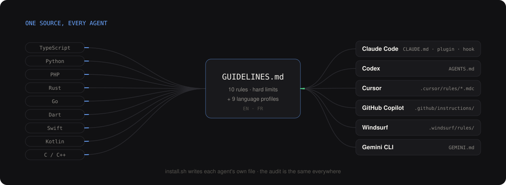

<div align="center">



```sh
curl -fsSL https://raw.githubusercontent.com/RemiPelloux/pelloux-guidelines/main/install.sh | bash
```

[Les règles](i18n/fr/GUIDELINES.md) &nbsp;·&nbsp; [Langages](#neuf-langages) &nbsp;·&nbsp; [Agents](#six-agents) &nbsp;·&nbsp; [Installation](#installation) &nbsp;·&nbsp; [L'audit](#laudit) &nbsp;·&nbsp; [Skills](#plugin-claude-code-et-skills) &nbsp;·&nbsp; [English](README.md)

[](https://github.com/RemiPelloux/pelloux-guidelines/actions/workflows/ci.yml)
[](LICENSE)
[](#neuf-langages)
[](#six-agents)
[](tools/pelloux_audit)

</div>

Les agents IA écrivent du code plus vite que quiconque ne peut le relire. Livrés à eux-mêmes, ils
produisent des fichiers de 600 lignes, des fonctions de 80 lignes et des signatures à sept
arguments, réécrivent du code que personne ne leur a demandé de toucher, et oublient des
`console.log`. Chacun de ces travers rend le diff plus dur à lire, et c'est la relecture qui fait
goulot d'étranglement.

Les Pelloux Guidelines, ce sont dix règles et quelques chiffres non négociables qui gardent le code
écrit par les agents assez court pour être relu. Elles sont assez courtes pour tenir dans le
contexte de chaque agent, et elles viennent avec un audit sans dépendance qui les vérifie dans la
boucle de l'agent, avant chaque commit et en CI. Le code legacy est tenu par le ratchet (cliquet) :
on peut les adopter dès aujourd'hui sur une grosse base de code, sans tout corriger avant.

Au départ, c'était le fichier de règles d'une seule équipe produit. Elles tournent aujourd'hui dans
plus de trente dépôts, en TypeScript, PHP, Python, Dart, Rust et Swift.

## Les dix règles

| | Règle | En une ligne |
|---|---|---|
| 1 | [Terminer le travail](i18n/fr/GUIDELINES.md#1-terminer-le-travail) | Un plan ou une liste d'étapes pour l'utilisateur, ce n'est pas terminé. L'exécuter, le vérifier. |
| 2 | [Réfléchir avant de coder](i18n/fr/GUIDELINES.md#2-réfléchir-avant-de-coder) | Énoncer ses hypothèses. Lister les lectures d'une demande floue. Demander. |
| 3 | [Choisir la correction la plus simple](i18n/fr/GUIDELINES.md#3-choisir-la-correction-la-plus-simple) | Nommer trois approches. Par défaut, corriger au point de défaillance. |
| 4 | [Faire court](i18n/fr/GUIDELINES.md#4-faire-court) | Pas d'abstraction utilisée une seule fois, pas d'option que personne n'a demandée. |
| 5 | [Ne changer que ce qui est demandé](i18n/fr/GUIDELINES.md#5-ne-changer-que-ce-qui-est-demandé) | Chaque ligne modifiée se rattache à la demande. |
| 6 | [Prouver](i18n/fr/GUIDELINES.md#6-prouver) | Reproduire d'abord. Tester le cas d'échec. Ne jamais mocker la fonctionnalité qu'on livre. |
| 7 | [Rester dans les limites](i18n/fr/GUIDELINES.md#7-rester-dans-les-limites) | Fichiers 400 lignes, modules d'entrée 200, fonctions 25, paramètres 3. |
| 8 | [Ne laisser aucune trace de debug](i18n/fr/GUIDELINES.md#8-ne-laisser-aucune-trace-de-debug) | Pas de sortie de debug, de code commenté, de tests focalisés ni de secrets. |
| 9 | [Committer en bon coéquipier](i18n/fr/GUIDELINES.md#9-committer-en-bon-coéquipier) | Conventional Commits, staging explicite, ne jamais écraser le travail d'un autre agent. |
| 10 | [Laisser la machine vérifier](i18n/fr/GUIDELINES.md#10-laisser-la-machine-vérifier) | Hook de l'agent, pre-commit, CI. Le code legacy peut rétrécir, jamais grossir. |

Le texte complet est dans [GUIDELINES.md](i18n/fr/GUIDELINES.md) (ou [en anglais](GUIDELINES.md)).
Cinq minutes de lecture.

## Les limites



| Périmètre | Cible | Limite stricte | L'audit échoue à |
|---|---|---|---|
| Fichier source | 300 lignes | 400 | 441 |
| Module d'entrée : controller, route handler, hook, service | 200 lignes | 200 | 221 |
| Fonction ou méthode | 25 lignes | 25 | 28 |
| Paramètres | 3 | 3, ou 4 en PHP, Python, Go, Rust, C et C++ | au-delà de la limite |

La longueur d'une fonction compte les lignes non vides et hors commentaires. Les receveurs (`self`,
`this`) ne comptent pas comme paramètres, et les constructeurs qui injectent des dépendances sont
exemptés. Les tests, les migrations, les fichiers de traduction, le code généré et le code
vendorisé échappent aux limites de taille, mais pas aux vérifications de debug.

## Neuf langages

Chaque profil ajoute des limites propres à la stack, les idiomes qui permettent de rester dedans,
les tokens de debug à détecter, et une config prête à coller pour le linter déjà en place.

| Profil | Fichiers | Params | Votre linter, configuré | Détecté par l'audit |
|---|---|---|---|---|
| [TypeScript et JavaScript](i18n/fr/languages/typescript.md) | `.ts .tsx .js .jsx .mjs .cjs` | 3 | ESLint | `console.log`, `debugger`, `it.only` |
| [Python](i18n/fr/languages/python.md) | `.py` | 4 | Ruff | `breakpoint()`, `pdb.set_trace()` |
| [PHP](i18n/fr/languages/php.md) | `.php` | 4 | PHPStan, PHPMD | `dd()`, `dump()`, `var_dump()`, `ray()` |
| [Rust](i18n/fr/languages/rust.md) | `.rs` | 4 | Clippy | `dbg!` |
| [Go](i18n/fr/languages/go.md) | `.go` | 4 | golangci-lint v2 | `println`, `spew` |
| [Dart et Flutter](i18n/fr/languages/dart.md) | `.dart` | 3 | Dart analyzer | `print()`, `debugger()` |
| [Swift](i18n/fr/languages/swift.md) | `.swift` | 3 | SwiftLint | `print()`, `debugPrint()`, `dump()` |
| [Kotlin](i18n/fr/languages/kotlin.md) | `.kt .kts` | 3 | detekt | `println`, `printStackTrace()` |
| [C et C++](i18n/fr/languages/cpp.md) | `.c .h .cc .cpp .hpp` | 4 | clang-tidy | `#if 0`, `printf("DEBUG` |

Chaque profil existe en anglais et en français (`--locale fr`).

## Six agents



Une seule source, écrite là où chaque agent regarde vraiment. Quand l'agent le permet, les profils
de langage ne s'attachent qu'aux fichiers concernés : ils ne coûtent aucun contexte dans le reste
de l'arbre.

| Agent | Ce que l'installeur écrit |
|---|---|
| Claude Code | Un bloc dans `CLAUDE.md` qui importe `.pelloux/GUIDELINES.md`. Le plugin ajoute quatre skills et un garde-fou de taille en direct. |
| Codex (et les autres lecteurs d'`AGENTS.md`) | Un bloc géré dans `AGENTS.md` avec les règles de base et vos profils |
| Cursor | `.cursor/rules/pelloux-guidelines.mdc` (toujours actif) et un `pelloux-<lang>.mdc` par profil, ciblé par glob |
| GitHub Copilot | Un bloc dans `.github/copilot-instructions.md` et `.github/instructions/pelloux-<lang>.instructions.md` avec `applyTo` |
| Windsurf | `.windsurf/rules/pelloux-guidelines.md` (toujours actif) et une règle déclenchée par glob pour chaque profil |
| Gemini CLI | Un bloc dans `GEMINI.md` qui importe `.pelloux/GUIDELINES.md` |

Les blocs se placent entre `<!-- pelloux:start -->` et `<!-- pelloux:end -->`. Relancer
l'installeur les remplace et laisse le reste du fichier intact.

## Installation

### Dans un dépôt

Depuis la racine du dépôt :

```sh
curl -fsSL https://raw.githubusercontent.com/RemiPelloux/pelloux-guidelines/main/install.sh | bash
```

Il détecte vos langages, écrit les règles pour Claude Code, Codex et Cursor, vendorise l'audit
dans `.pelloux/`, initialise `pelloux-baseline.json` avec les violations du jour, et ajoute le hook
pre-commit (dans Husky si le dépôt l'utilise). Pour prévisualiser d'abord : `--dry-run`. Les
options se placent après `bash -s --` :

```sh
curl -fsSL https://raw.githubusercontent.com/RemiPelloux/pelloux-guidelines/main/install.sh \
  | bash -s -- --agents all --ci --locale fr
```

| Option | Par défaut | |
|---|---|---|
| `--agents` | `claude,codex,cursor` | Liste séparée par des virgules, ou `all` pour les six |
| `--lang` | détecté | `typescript,python,php,rust,go,dart,swift,kotlin,cpp` |
| `--locale` | `en` | `fr` pour les règles en français |
| `--ci` | désactivé | Ajoute `.github/workflows/pelloux.yml` |
| `--rules-only` | désactivé | Les règles seules : ni audit, ni baseline, ni hook |
| `--skills` | désactivé | Copie aussi les skills dans `~/.claude/skills` et dans Codex |
| `--dry-run` | désactivé | Montre ce qui changerait |

Ensuite, committer la baseline seule (`chore(pelloux): seed the size baseline`) et le reste dans un
second commit. Il faut Python 3.10 ou plus récent, rien d'autre.

### En plugin Claude Code

```text
/plugin marketplace add RemiPelloux/pelloux-guidelines
/plugin install pelloux-guidelines@pelloux-guidelines
```

### Uniquement les skills, pour n'importe quel agent

```sh
npx skills add RemiPelloux/pelloux-guidelines
```

### À la main

Copier [GUIDELINES.md](i18n/fr/GUIDELINES.md) et les profils utiles dans le fichier de règles de
votre agent. Les règles fonctionnent sans l'outillage. L'outillage garantit qu'elles continuent de
fonctionner.

## L'audit

```sh
python3 .pelloux/pelloux.py audit             # the whole tree
python3 .pelloux/pelloux.py audit --staged    # what is about to be committed
python3 .pelloux/pelloux.py audit --json      # for agents and scripts
python3 .pelloux/pelloux.py seed              # record today's violations
```

```text
Pelloux audit · 214 files · TypeScript/JavaScript, Python

  ERROR  src/services/billing.ts:1  entry module has 286 lines (limit 200)
  ERROR  src/services/billing.ts:88  createInvoice() has 48 lines (limit 25)
  ERROR  src/api/reminders.ts:12  sendReminder() takes 5 parameters (limit 3)
  WARN   src/pages/Home.tsx:1  file has 342 lines (target 300)

✗ 3 errors · 1 warning · 12 baselined held
```

Un fichier Python par responsabilité, bibliothèque standard uniquement, et soumis à ses propres
limites. Il neutralise les chaînes et les commentaires avant de lire le code : une accolade dans une
chaîne ou un `console.log` dans un commentaire ne le trompent jamais, et les commentaires ne
comptent jamais dans la longueur d'une fonction. Il scanne les 10 600 fichiers du frontend
d'OpenPro en une dizaine de secondes ; une vérification des fichiers stagés prend une fraction de
seconde.

### Le ratchet



`seed` écrit chaque violation actuelle dans `pelloux-baseline.json`, avec sa taille comme plafond.
Un fichier ou une fonction de la liste peut rétrécir, jamais grossir, et rien de nouveau ne peut y
entrer. Quand l'audit signale des entrées corrigées, relancer `seed` pour verrouiller le progrès.
L'ancien format de baseline `oversized_files` est aussi pris en charge.

### Dans la boucle de l'agent

Le plugin Claude Code lance l'audit sur chaque fichier que l'agent écrit ou modifie. Quand une
modification dépasse une limite stricte, l'agent est prévenu tout de suite, avec la fonction et le
chiffre, et corrige avant de passer à la suite. Un hook cassé ne bloque jamais l'agent : en cas
d'erreur interne, il reste silencieux.

### En CI

Avec `--ci`, l'installeur ajoute un workflow qui lance l'audit vendorisé. Ou utiliser directement
l'action :

```yaml
- uses: RemiPelloux/pelloux-guidelines@v1
```

Sur GitHub Actions, les erreurs apparaissent en annotations sur la pull request.

### Configuration

Un `pelloux.json` optionnel à la racine du dépôt. Les listes s'ajoutent aux valeurs par défaut.

```json
{
  "languages": ["typescript", "python"],
  "tolerance": 0.1,
  "file": { "target": 300, "limit": 400 },
  "module": { "limit": 200, "paths": ["src/features/*/api/**"] },
  "function": { "limit": 25 },
  "params": { "python": 3 },
  "exclude": ["legacy/**"],
  "sizeExempt": ["src/legal/**"]
}
```

Pour ignorer une fonction, mettre un commentaire `pelloux-ignore` sur la ligne de sa signature ou
sur la ligne du dessus, et dire pourquoi. Chemins de modules d'entrée par défaut : `hooks/`,
`services/`, `controllers/`, `routes/`, `handlers/`.

## Plugin Claude Code et skills

| Skill | Rôle |
|---|---|
| `pelloux-guidelines` | Les règles elles-mêmes, avec le profil du fichier en cours de modification chargé à la demande |
| `pelloux-install` | Met en place les guidelines dans le dépôt courant, du dry run aux deux commits |
| `pelloux-audit` | Lance l'audit et corrige les erreurs avec le plus petit changement, sans toucher aux limites ni à la baseline |
| `pelloux-review` | Relit un diff ou une pull request au regard des limites machine et des règles de jugement qu'aucun linter ne vérifie |

## Dépôt

| Chemin | |
|---|---|
| `GUIDELINES.md`, `languages/` | Les règles, en anglais |
| `i18n/fr/` | La même chose, en français |
| `tools/` | L'audit : `pelloux.py` et le package `pelloux_audit` |
| `installer/`, `install.sh` | L'installeur |
| `skills/`, `hooks/`, `.claude-plugin/` | Le plugin Claude Code |
| `action.yml` | La GitHub Action |
| `scripts/build.py` | Régénère le skill à partir de `GUIDELINES.md` ; la CI échoue en cas d'écart |
| `tests/` | Tests unitaires pour chaque langage et pour le ratchet |

## Contribuer

Issues et pull requests bienvenues. Un nouveau langage demande un profil dans `languages/` et
`i18n/fr/languages/`, une ligne dans `tools/pelloux_audit/languages.py`, un pattern de signature et
des tests. Le projet suit ses propres règles : `python3 tools/pelloux.py audit` et les tests
unitaires doivent passer. Voir [CONTRIBUTING.md](CONTRIBUTING.md).

## Licence

[MIT](LICENSE). Écrit par [Rémi Pelloux](https://remipelloux.github.io/).
