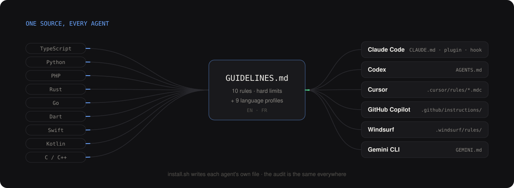

<div align="center">



```sh
curl -fsSL https://raw.githubusercontent.com/RemiPelloux/pelloux-guidelines/main/install.sh | bash
```

[The rules](GUIDELINES.md) &nbsp;·&nbsp; [Languages](#nine-languages) &nbsp;·&nbsp; [Agents](#six-agents) &nbsp;·&nbsp; [Install](#install) &nbsp;·&nbsp; [The audit](#the-audit) &nbsp;·&nbsp; [Skills](#claude-code-plugin-and-skills) &nbsp;·&nbsp; [Français](README.fr.md)

[](https://github.com/RemiPelloux/pelloux-guidelines/actions/workflows/ci.yml)
[](LICENSE)
[](#nine-languages)
[](#six-agents)
[](tools/pelloux_audit)

</div>

AI agents write code faster than anyone can review it. Left alone they write 600-line files,
80-line functions and seven-argument signatures, rewrite code nobody asked them to touch, and
leave `console.log` behind. Every one of those makes the diff harder to read, and the reviewer is
the bottleneck.

The Pelloux Guidelines are ten rules and a few hard numbers that keep agent-written code small
enough to review. They are short enough to sit in every agent's context, and they come with a
zero-dependency audit that checks them in the agent loop, before every commit and in CI. Legacy
code is held by a ratchet, so you can adopt them on a large codebase today without fixing it first.

They started as the rule file of one product team and now run in more than thirty repositories,
across TypeScript, PHP, Python, Dart, Rust and Swift.

## The ten rules

| | Rule | In one line |
|---|---|---|
| 1 | [Finish the work](GUIDELINES.md#1-finish-the-work) | A plan or a list of steps for the user is not done. Run it, verify it. |
| 2 | [Think before coding](GUIDELINES.md#2-think-before-coding) | State assumptions. List the readings of an unclear request. Ask. |
| 3 | [Pick the simplest fix](GUIDELINES.md#3-pick-the-simplest-fix) | Name three approaches. Default to the fix at the failure point. |
| 4 | [Keep it small](GUIDELINES.md#4-keep-it-small) | No abstraction used once, no option nobody asked for. |
| 5 | [Change only what was asked](GUIDELINES.md#5-change-only-what-was-asked) | Every changed line traces back to the request. |
| 6 | [Prove it](GUIDELINES.md#6-prove-it) | Reproduce first. Test the failure path. Never mock the feature you ship. |
| 7 | [Stay inside the limits](GUIDELINES.md#7-stay-inside-the-limits) | Files 400 lines, entry modules 200, functions 25, parameters 3. |
| 8 | [Leave no debug behind](GUIDELINES.md#8-leave-no-debug-behind) | No debug output, commented-out code, focused tests or secrets. |
| 9 | [Commit like a teammate](GUIDELINES.md#9-commit-like-a-teammate) | Conventional Commits, explicit staging, never overwrite another agent's work. |
| 10 | [Let the machine check](GUIDELINES.md#10-let-the-machine-check) | Agent hook, pre-commit, CI. Legacy code may shrink, never grow. |

Read the full text in [GUIDELINES.md](GUIDELINES.md) (or [in French](i18n/fr/GUIDELINES.md)). It
takes five minutes.

## The limits



| Scope | Target | Hard limit | The audit fails at |
|---|---|---|---|
| Source file | 300 lines | 400 | 441 |
| Entry module: controller, route handler, hook, service | 200 lines | 200 | 221 |
| Function or method | 25 lines | 25 | 28 |
| Parameters | 3 | 3, or 4 in PHP, Python, Go, Rust, C and C++ | over the limit |
| Relative import | 2 levels up (`../../`) | 2 | `../../../` and deeper |

Function length counts non-blank, non-comment lines. Receivers (`self`, `this`) do not count as
parameters, and constructors that inject dependencies are exempt. Tests, migrations, locales,
generated and vendored code are exempt from size limits but not from the debug checks.

Deep relative imports are a code smell the audit catches in TypeScript, JavaScript, Python, PHP,
Dart, Rust and C/C++: `../../../lib/x` breaks when either file moves and hides where the code
lives. The message names the fix for the language: a `@/` alias, an absolute import, `package:`,
`crate::` or the include path.

## Nine languages

Each profile adds stack-specific limits, the idioms that keep code inside them, the debug tokens to
catch, and a ready-to-paste config for the linter you already use.

| Profile | Files | Params | Your linter, configured | Caught by the audit |
|---|---|---|---|---|
| [TypeScript and JavaScript](languages/typescript.md) | `.ts .tsx .js .jsx .mjs .cjs` | 3 | ESLint | `console.log`, `debugger`, `it.only` |
| [Python](languages/python.md) | `.py` | 4 | Ruff | `breakpoint()`, `pdb.set_trace()` |
| [PHP](languages/php.md) | `.php` | 4 | PHPStan, PHPMD | `dd()`, `dump()`, `var_dump()`, `ray()` |
| [Rust](languages/rust.md) | `.rs` | 4 | Clippy | `dbg!` |
| [Go](languages/go.md) | `.go` | 4 | golangci-lint v2 | `println`, `spew` |
| [Dart and Flutter](languages/dart.md) | `.dart` | 3 | Dart analyzer | `print()`, `debugger()` |
| [Swift](languages/swift.md) | `.swift` | 3 | SwiftLint | `print()`, `debugPrint()`, `dump()` |
| [Kotlin](languages/kotlin.md) | `.kt .kts` | 3 | detekt | `println`, `printStackTrace()` |
| [C and C++](languages/cpp.md) | `.c .h .cc .cpp .hpp` | 4 | clang-tidy | `#if 0`, `printf("DEBUG` |

Every profile exists in English and in French (`--locale fr`).

## Six agents



One source, written where each agent actually looks. Language profiles attach only to matching
files where the agent supports it, so they cost no context in the rest of the tree.

| Agent | What the installer writes |
|---|---|
| Claude Code | A block in `CLAUDE.md` that imports `.pelloux/GUIDELINES.md`. The plugin adds four skills and a live size guard. |
| Codex (and other `AGENTS.md` readers) | A managed block in `AGENTS.md` with the core rules and your profiles |
| Cursor | `.cursor/rules/pelloux-guidelines.mdc` (always on) and one `pelloux-<lang>.mdc` per profile, scoped by glob |
| GitHub Copilot | A block in `.github/copilot-instructions.md` and `.github/instructions/pelloux-<lang>.instructions.md` with `applyTo` |
| Windsurf | `.windsurf/rules/pelloux-guidelines.md` (always on) and one glob-triggered rule per profile |
| Gemini CLI | A block in `GEMINI.md` that imports `.pelloux/GUIDELINES.md` |

Blocks sit between `<!-- pelloux:start -->` and `<!-- pelloux:end -->`. Re-running the installer
replaces them and leaves the rest of your file alone.

## Install

### Into a repository

From the repository root:

```sh
curl -fsSL https://raw.githubusercontent.com/RemiPelloux/pelloux-guidelines/main/install.sh | bash
```

It detects your languages, writes the rules for Claude Code, Codex and Cursor, vendors the audit
into `.pelloux/`, seeds `pelloux-baseline.json` with today's violations, and adds the pre-commit
hook (into Husky when the repository uses it). Preview first with `--dry-run`. Options go after
`bash -s --`:

```sh
curl -fsSL https://raw.githubusercontent.com/RemiPelloux/pelloux-guidelines/main/install.sh \
  | bash -s -- --agents all --ci --locale fr
```

| Option | Default | |
|---|---|---|
| `--agents` | `claude,codex,cursor` | Comma list, or `all` for the six |
| `--lang` | detected | `typescript,python,php,rust,go,dart,swift,kotlin,cpp` |
| `--locale` | `en` | `fr` for the French rules |
| `--ci` | off | Adds `.github/workflows/pelloux.yml` |
| `--rules-only` | off | Rules only: no audit, baseline or hook |
| `--skills` | off | Also copies the skills into `~/.claude/skills` and Codex |
| `--dry-run` | off | Show what would change |

Then commit the baseline on its own (`chore(pelloux): seed the size baseline`) and the rest in a
second commit. Requires Python 3.10 or newer, nothing else.

### As a Claude Code plugin

```text
/plugin marketplace add RemiPelloux/pelloux-guidelines
/plugin install pelloux-guidelines@pelloux-guidelines
```

### The skills only, for any agent

```sh
npx skills add RemiPelloux/pelloux-guidelines
```

### By hand

Copy [GUIDELINES.md](GUIDELINES.md) and the profiles you need into your agent's rule file. The
rules work without the tooling. The tooling makes sure they keep working.

## The audit

```sh
python3 .pelloux/pelloux.py audit             # the whole tree
python3 .pelloux/pelloux.py audit --staged    # what is about to be committed
python3 .pelloux/pelloux.py audit --json      # for agents and scripts
python3 .pelloux/pelloux.py seed              # record today's violations
```

```text
Pelloux audit · 214 files · TypeScript/JavaScript, Python

  ERROR  src/services/billing.ts:1  entry module has 286 lines (limit 200)
  ERROR  src/services/billing.ts:88  createInvoice() has 48 lines (limit 25)
  ERROR  src/api/reminders.ts:12  sendReminder() takes 5 parameters (limit 3)
  WARN   src/pages/Home.tsx:1  file has 342 lines (target 300)

✗ 3 errors · 1 warning · 12 baselined held
```

One Python file per concern, standard library only, under its own limits. It blanks out strings
and comments before it reads code, so a brace in a string or a `console.log` in a comment never
confuses it, and comments never count toward function length. It scans OpenPro's 10,600-file
frontend in about ten seconds; a staged check takes a fraction of a second.

### The ratchet



`seed` writes every current violation to `pelloux-baseline.json` with its size as a ceiling. A
listed file or function may shrink, never grow, and nothing new may join the list. When the audit
reports fixed entries, run `seed` again to lock the progress in. The older `oversized_files`
baseline format is read as well.

### In the agent loop

The Claude Code plugin runs the audit on every file the agent writes or edits. When an edit breaks
a hard limit, the agent is told at once, with the function and the number, and fixes it before it
moves on. A broken hook never blocks the agent: on any internal error it stays silent.

### In CI

The installer's `--ci` adds a workflow that runs the vendored audit. Or use the action directly:

```yaml
- uses: RemiPelloux/pelloux-guidelines@v1
```

On GitHub Actions the errors appear as annotations on the pull request.

### Configuration

Optional `pelloux.json` at the repository root. Lists add to the defaults.

```json
{
  "languages": ["typescript", "python"],
  "tolerance": 0.1,
  "file": { "target": 300, "limit": 400 },
  "module": { "limit": 200, "paths": ["src/features/*/api/**"] },
  "function": { "limit": 25 },
  "imports": { "maxParentDepth": 2 },
  "params": { "python": 3 },
  "exclude": ["legacy/**"],
  "sizeExempt": ["src/legal/**"]
}
```

Set `maxParentDepth` to `null` to turn the import check off. Skip one function with a `pelloux-ignore` comment on its signature line or the line above, and
say why. Default entry-module paths: `hooks/`, `services/`, `controllers/`, `routes/`,
`handlers/`.

## Claude Code plugin and skills

| Skill | What it does |
|---|---|
| `pelloux-guidelines` | The rules themselves, with the profile for the file being edited loaded on demand |
| `pelloux-install` | Sets the guidelines up in the current repository, from dry run to the two commits |
| `pelloux-audit` | Runs the audit and fixes the errors with the smallest change, without touching limits or the baseline |
| `pelloux-review` | Reviews a diff or a pull request against the machine limits and the judgment rules no linter checks |

## Repository

| Path | |
|---|---|
| `GUIDELINES.md`, `languages/` | The rules, in English |
| `i18n/fr/` | The same, in French |
| `tools/` | The audit: `pelloux.py` and the `pelloux_audit` package |
| `installer/`, `install.sh` | The installer |
| `skills/`, `hooks/`, `.claude-plugin/` | The Claude Code plugin |
| `action.yml` | The GitHub Action |
| `scripts/build.py` | Regenerates the skill from `GUIDELINES.md`; CI fails if they drift |
| `tests/` | Unit tests for every language and for the ratchet |

## Contributing

Issues and pull requests are welcome. A new language needs a profile in `languages/` and
`i18n/fr/languages/`, a row in `tools/pelloux_audit/languages.py`, a signature pattern and tests.
The project follows its own rules: `python3 tools/pelloux.py audit` and the unit tests must pass.
See [CONTRIBUTING.md](CONTRIBUTING.md).

## License

[MIT](LICENSE). Written by [Rémi Pelloux](https://remipelloux.github.io/).
